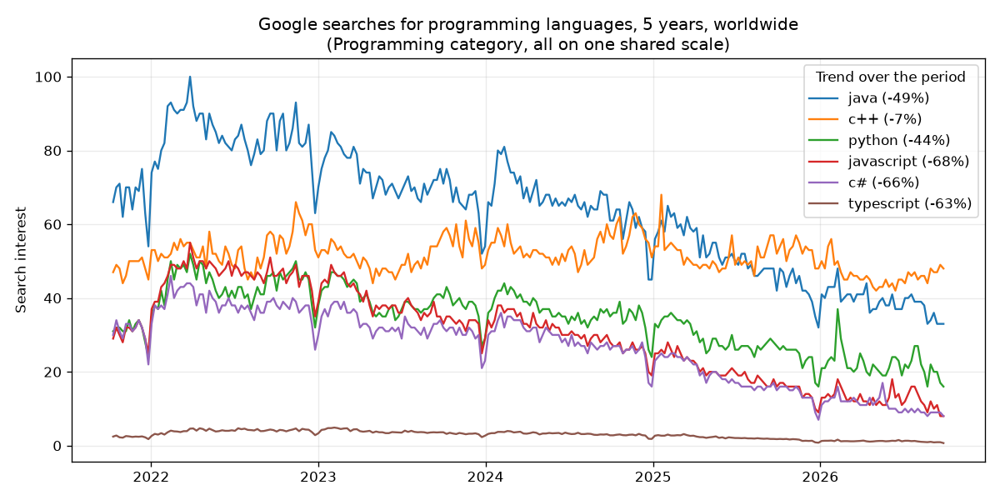

# Google Trends in Python without pytrends (and comparing more than 5 keywords)

I wanted one simple chart: how much do people google the big programming languages now, compared with a few years ago? Ten languages, five years, one chart.

That turned out to be harder than it sounds, for two reasons.

**pytrends is gone.** The library most tutorials use was archived in April 2025. Install it today and the first request often fails with `429 Too Many Requests`, and nobody is merging fixes anymore. Google did announce an official Trends API in July 2025, but it's an alpha you have to apply for.

**Google Trends compares at most 5 keywords at a time.** And every comparison is scaled so that its own peak is 100, so you can't just glue two comparisons together.

Here's how I got around both, and the result, which surprised me.

## What happens when you open Google Trends

The Trends website is a JavaScript app that gets its data from two JSON endpoints:

1. `/trends/api/explore` takes your keywords and returns a list of widgets (the chart, the map, related searches), each with a token.
2. `/trends/api/widgetdata/...` takes a widget's request plus its token and returns the actual numbers.

You also need Google's `NID` cookie, which you get by loading any Trends page first. That's the step a lot of old code misses. With plain `requests` the whole thing is about 20 lines. It's also in this repo as [`examples/raw_endpoints.py`](../examples/raw_endpoints.py).

```python
import json
from datetime import datetime, timezone

import requests


def google_json(text):
    return json.loads(text[text.index("{"):])  # answers start with a ")]}'" guard line


s = requests.Session()
s.headers["User-Agent"] = "Mozilla/5.0 (Windows NT 10.0; Win64; x64) AppleWebKit/537.36 (KHTML, like Gecko) Chrome/129.0 Safari/537.36"
s.get("https://trends.google.com/trends/explore?geo=US")  # sets the NID cookie, even when it answers 429

req = {"comparisonItem": [{"keyword": "matcha", "geo": "US", "time": "today 12-m"}], "category": 0, "property": ""}
r = s.get("https://trends.google.com/trends/api/explore", params={"hl": "en-US", "tz": 0, "req": json.dumps(req)})
widgets = google_json(r.text)["widgets"]

timeseries = next(w for w in widgets if w["id"] == "TIMESERIES")
r = s.get(
    "https://trends.google.com/trends/api/widgetdata/multiline",
    params={"hl": "en-US", "tz": 0, "req": json.dumps(timeseries["request"]), "token": timeseries["token"]},
)
for point in google_json(r.text)["default"]["timelineData"][-3:]:
    day = datetime.fromtimestamp(int(point["time"]), tz=timezone.utc).date()
    print(day, point["value"][0])
```

That's fine for a handful of keywords. It gets harder when you need more:

- Google rate-limits per IP, and fairly quickly. For anything regular you need rotating IPs and retries.
- Each request takes at most 5 keywords, and each request is scaled on its own.

## Comparing more than 5 keywords on one scale

The trick is to link the comparisons through shared keywords:

1. Split your keywords into groups of 5 and request each group.
2. Take the most searched keyword of each group, its "leader", and compare the leaders with each other in one more request. With more than 5 groups, chain a few of these bridge requests, overlapping by one leader.
3. Every leader now has a value in its own group and a value in the bridge. The ratio between the two is the factor for its whole group. Rescale each group, then rescale everything so the highest point is 100.

For example: if Java scores 100 in its group but 40 in the bridge, every keyword in Java's group gets multiplied by 0.4. Linking through the leaders keeps the numbers large, so Google's rounding to whole numbers hurts less.

## What I ended up using

I didn't want to babysit proxies, so I put all of this into a scraper on Apify: the cookies, rotating IPs, retries, the group linking above, and a few trend metrics. Full disclosure: I built it. It's called [Google Trends Scraper](https://apify.com/ralfij/google-trends-scraper) and you pay per keyword. Apify's free plan gives $5 of credit a month, which covers about 2,500 keywords.

From Python it's one call. The full version, which also saves a CSV, is [`examples/compare_keywords.py`](../examples/compare_keywords.py).

```python
import os

from apify_client import ApifyClient

client = ApifyClient(os.environ["APIFY_TOKEN"])
run = client.actor("ralfij/google-trends-scraper").call(run_input={
    "keywords": ["python", "javascript", "java", "c++", "c#", "go", "rust", "kotlin", "swift", "typescript"],
    "comparison": "shared",  # all keywords on one scale
    "timeRange": "today 5-y",
    "category": 31,          # Programming
})
for row in client.dataset(run.default_dataset_id).iterate_items():
    print(row["keyword"], row["shareOfSearch"], row["trendChangePercent"])
```

This is what came out (worldwide, Programming category, October 2021 to October 2026):

| Language | Share of search | Trend |
|---|---|---|
| Java | 29.4% | -48.8% |
| C++ | 23.8% | -7.1% |
| Python | 15.8% | -43.7% |
| JavaScript | 14.0% | -67.8% |
| C# | 12.3% | -66.2% |
| TypeScript | 1.3% | -62.6% |
| Go | 1.2% | -17.5% |
| Rust | 0.8% | +2.6% |
| Kotlin | 0.7% | -61.7% |
| Swift | 0.7% | -64.6% |

"Trend" compares the last quarter of the period with the first quarter.



Two things stood out to me:

- **Search interest dropped for almost every language,** most of them by 40-68%. Google Trends measures a keyword's share of all searches, so this doesn't mean fewer people program. My guess is that a lot of the questions people used to google now go to an AI assistant instead. C++ and Rust held steady.
- **The category matters a lot.** Without the Programming category, "go" and "swift" win easily, because they're also everyday words.

## A few things to know about Google Trends data

- **The numbers are relative, not search volumes.** 100 is the busiest point in your chart, and everything else is a percentage of that.
- **Small keywords next to big ones show up as 0.** Google rounds to whole numbers. Compare keywords of a similar size when you can.
- **The last point is usually incomplete.** The current week or day is still running, so it tends to look like a drop.
- **Rising related searches can be odd.** In October 2026 the top "rising" searches for *coffee* in the US included "sports scores today" and "pet care tips". The Google Trends website shows exactly the same list, so it's Google's data, not a scraping error. Filter what you don't need.

## Other options

- **A few keywords now and then:** the `requests` snippet above is enough.
- **A maintained Python library:** [trendspyg](https://github.com/flack0x/trendspyg) is one of the actively maintained pytrends alternatives. You still deal with rate limits yourself.
- **Paid SERP APIs** such as SerpApi have Google Trends endpoints, with a monthly subscription.
- **Google's official Trends API,** if you get into the alpha.

All the code from this tutorial is in this repo, with setup steps in the [README](../README.md). If you have a question about Google Trends data, open an issue and I'll try to help.
